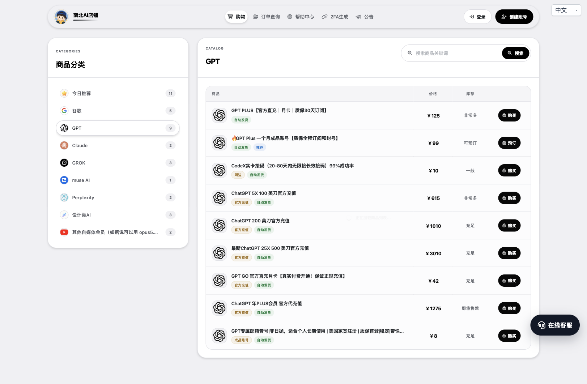
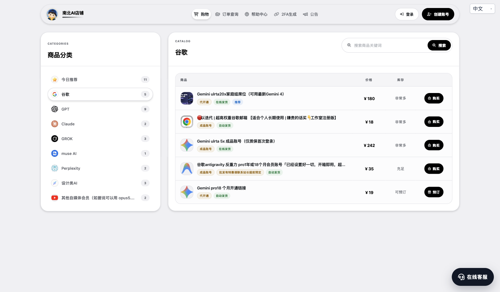
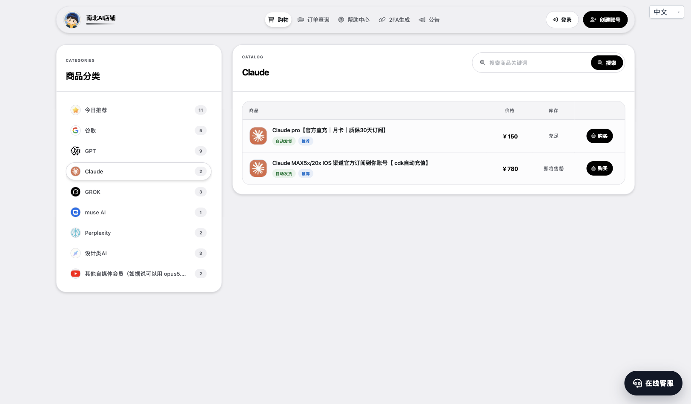
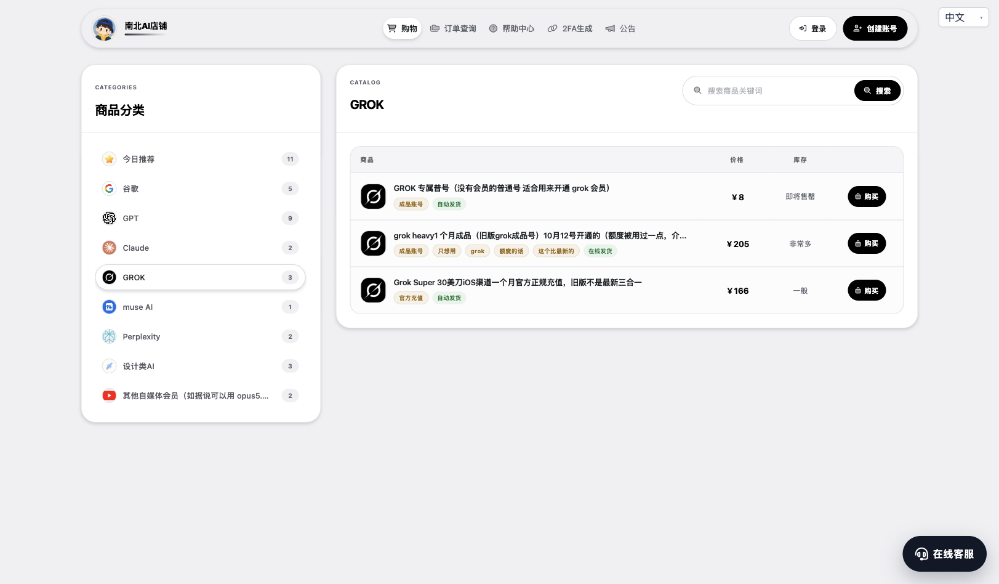
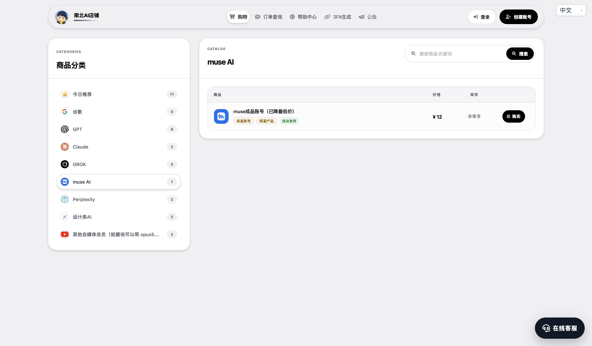
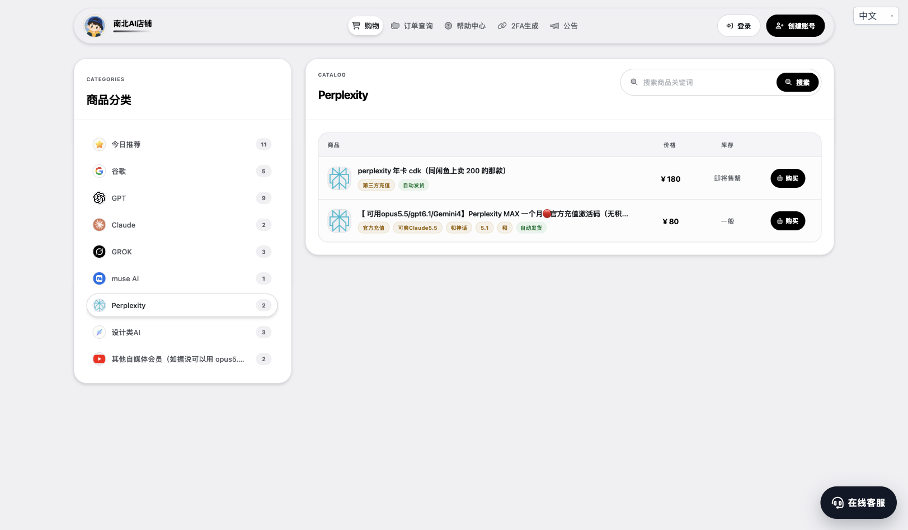
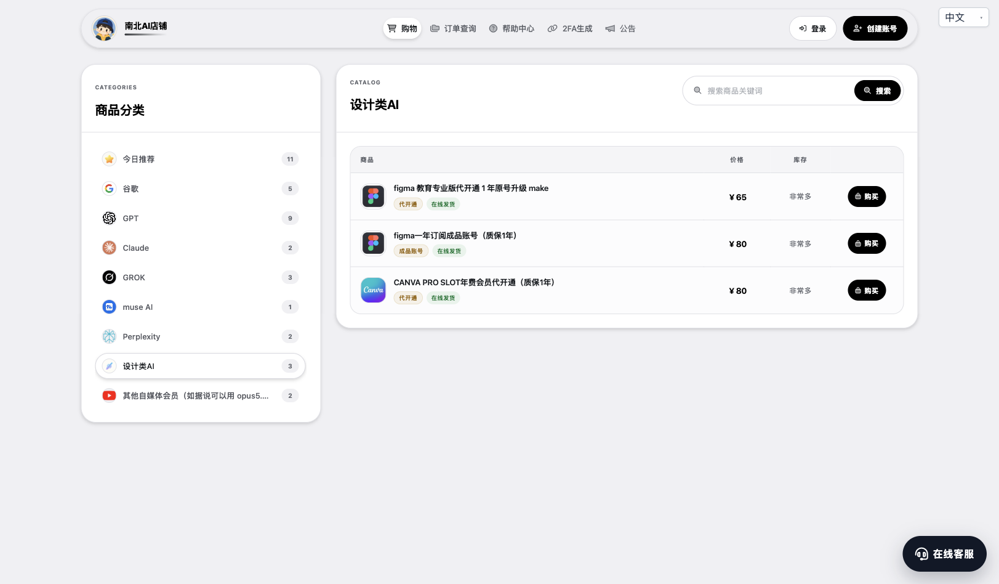
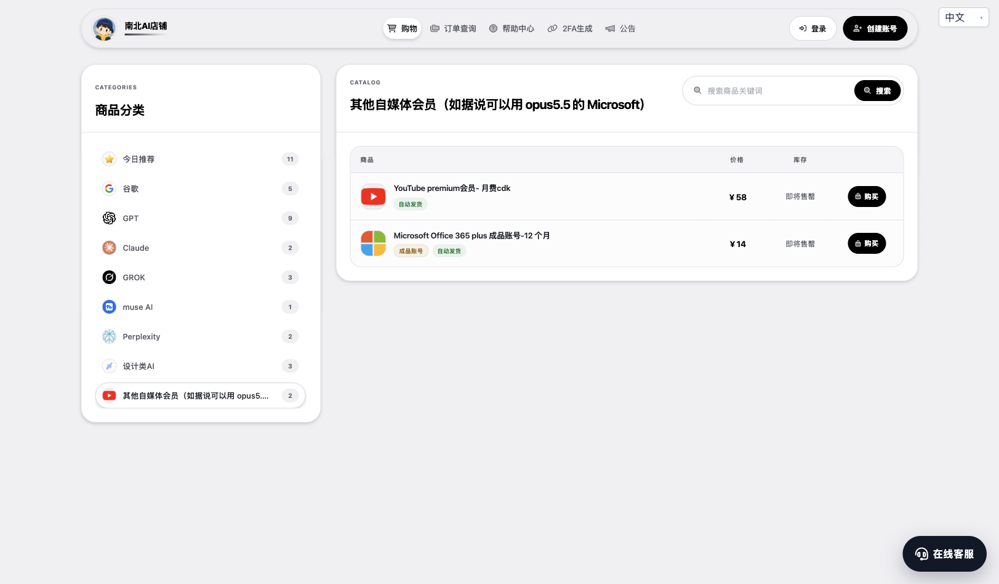

# 南北 AI 店铺｜AI 充值、代充与会员服务

**价格实在，选择齐全，质保规则看得见。**

提供 ChatGPT、Claude、Gemini、Grok 等 AI 充值、代充与会员服务。从日常写作、编程、资料检索，到设计制作与办公娱乐，常用 AI 和会员服务在这里集中选。原号充值、代开通、成品账号、家庭组席位，按自己的预算与使用习惯挑选。

## [进入南北 AI 店铺 → nanbei-ai.store](https://nanbei-ai.store/)

[查看全部商品](https://nanbei-ai.store/) · [订单查询](https://nanbei-ai.store/user/index/query) · [帮助中心](https://nanbei-ai.store/user/help/index)

## 为什么选择南北 AI 店铺

### 多个价位可选，把预算花在需要的功能上

GPT GO 月卡 ¥42、GPT Plus 月卡 ¥125 起、Claude Pro 月卡 ¥150、Perplexity MAX 月卡 ¥80。设计工具有 Figma 教育专业版代开通 ¥65 和 Canva Pro 团队席位年费方案 ¥80，不同用途都有对应选择。

想保留自己的账号，可以看原号充值与代开通；想选成品账号，也有单独的商品入口。价格、商品类型和库存并排展示，方便先比较方案，再决定购买。

### 质保按商品写清，长短期需求都能选

| 商品 | 页面列明的质保与服务 | 购买时注意 |
| --- | --- | --- |
| [GPT Plus 月卡](https://nanbei-ai.store/item/51) | 提供质保方案，覆盖会员有效期内的异常掉线 | 不含账号封禁、模型效果或平台卡顿；按所选渠道及规格执行 |
| [Claude Pro 月卡](https://nanbei-ai.store/item/46) | 全程质保方案：会员期间异常掉线，按使用天数退款 | 不含账号封禁；不能覆盖未到期会员，账号及账单需符合充值要求 |
| [Gemini Ultra 家庭组席位](https://nanbei-ai.store/item/27) | 多个周期标注全程质保；家庭组停用时重新邀请进组 | 5 人共享额度；个人账号、地区及换号条件请先查看详情 |
| [Figma 一年成品账号](https://nanbei-ai.store/item/171) | 详情列明购买后保修 365 天 | 到手需修改密码，不改密码无售后 |
| [Canva Pro 年费团队席位](https://nanbei-ai.store/item/172) | 商品标题标注质保 1 年，联系客服开通 | 核对邮箱，填错且开通成功不退款；具体处理范围请先咨询 |

各商品质保单独执行，不同类型的服务范围不同。选择前看清详情，有疑问可通过网站右下角在线客服确认。

### 8 大品类集中选，减少来回寻找

GPT、谷歌、Claude、Grok、muse AI、Perplexity、设计类 AI，以及其他会员服务均有独立分类。既能选择日常使用的 AI 工具，也能一起查看设计、办公与视频会员方案。

### 部分商品自动发货，订单可自行查询

标注“自动发货”的商品按页面流程交付卡密或账号；代开通、家庭组等标注在线发货的商品由客服处理。下单后可通过站内订单查询入口查看记录，具体激活方法见商品详情。

## 全品类一览

以下为 2026 年 10 月 25 日的页面价格与截图，实际成交价、库存、权益和质保以商品详情及所选规格为准。分类列表价可能为起售价，成品账号、共享席位与原号充值的权益不能直接等同。

### GPT｜日常使用到高档位充值

[查看 GPT 全部商品 →](https://nanbei-ai.store/cat/12)

GO、Plus 月卡、Plus 年卡及其他档位集中展示，适合按预算和使用频率选择。自己的号充值与成品账号分开购买。

| 代表商品 | 页面价格 | 说明 |
| --- | ---: | --- |
| [GPT GO 月卡](https://nanbei-ai.store/item/152) | ¥42 | 原号充值，具体功能以套餐为准 |
| [GPT Plus 月卡](https://nanbei-ai.store/item/51) | ¥125 起 | 渠道 1 为 ¥125，渠道 3 为 ¥130，账号条件不同 |
| [GPT Plus 一个月成品账号](https://nanbei-ai.store/item/84) | ¥99 | 当前显示可预订 |
| [GPT Plus 年卡](https://nanbei-ai.store/item/269) | ¥1275 | 年度方案，查看详情确认适用条件 |

### 谷歌｜Gemini、Antigravity 与账号服务

[查看谷歌全部商品 →](https://nanbei-ai.store/cat/13)

家庭组席位、成品账号、开通链接和邮箱账号等类型齐全，可以根据是否使用自己的账号、是否接受共享额度来选。

| 代表商品 | 页面价格 | 说明 |
| --- | ---: | --- |
| [Gemini Ultra 20x 家庭组席位](https://nanbei-ai.store/item/27) | ¥180／月起 | 5 人共享额度，多个周期可选，部分方案无 Flow 积分 |
| [Antigravity Pro 会员账号](https://nanbei-ai.store/item/85) | ¥35 起 | 页面列出 1 年或 18 个月方案，按所选规格确认 |
| [Gemini Ultra 5x 成品账号](https://nanbei-ai.store/item/488) | ¥242 | 仅质保首次登录 |
| [Gemini Pro 18 个月开通链接](https://nanbei-ai.store/item/490) | ¥19 | 当前显示可预订，使用条件见详情 |

家庭组由客服邀请进组，可能需要等待，不适合要求立即使用的订单。共享方案的实际可用额度取决于共同使用情况。

### Claude｜Pro 月卡与 MAX 档位

[查看 Claude 全部商品 →](https://nanbei-ai.store/cat/14)

Pro 月卡与 MAX 方案分开选择，既有日常使用档位，也有更高档位的充值入口。

| 代表商品 | 页面价格 | 说明 |
| --- | ---: | --- |
| [Claude Pro 月卡](https://nanbei-ai.store/item/46) | ¥150 | 选择对应质保规格，先核对账号条件 |
| [Claude MAX 5x／20x](https://nanbei-ai.store/item/127) | ¥780 起 | 多规格商品，价格以所选档位为准 |

Claude 充值限制较多：未到期会员、逾期账单及部分账号状态可能不适用。请先阅读详情并联系客服确认，避免选错。

### Grok｜充值与成品账号分开选

[查看 Grok 全部商品 →](https://nanbei-ai.store/cat/15)

提供普通账号、Super 充值和 Heavy 成品账号等选择，方便区分“只需要账号”和“需要会员服务”的需求。

| 代表商品 | 页面价格 | 说明 |
| --- | ---: | --- |
| [Grok 普通账号](https://nanbei-ai.store/item/285) | ¥8 | 不含会员 |
| [Grok Super 一个月充值](https://nanbei-ai.store/item/211) | ¥166 | 页面注明旧版方案，非最新三合一 |
| [Grok Heavy 成品账号](https://nanbei-ai.store/item/385) | ¥205 | 旧版账号，10 月 12 日已开通且部分额度已使用；剩余有效期和额度需先确认 |

### muse AI｜低预算成品账号选择

[查看 muse AI 全部商品 →](https://nanbei-ai.store/cat/251)

同一商品提供不同额度规格，方便按需求选择。详情页显示 10 亿额度成品号 ¥12、310 亿额度成品号 ¥45，具体剩余额度以交付时为准。

[查看 muse 成品账号 →](https://nanbei-ai.store/item/442)

该商品仅质保下单后 1 小时，页面要求美国 IP 环境，首次登录后应及时按说明换绑邮箱并移除原邮箱；不保证换绑一定成功。购买前请先阅读环境要求与售后条款。

### Perplexity｜月卡与年卡方案

[查看 Perplexity 全部商品 →](https://nanbei-ai.store/cat/70)

短期体验可看月卡，长期需求可查看年卡；套餐权益和激活条件以各自详情为准。

| 代表商品 | 页面价格 | 说明 |
| --- | ---: | --- |
| [Perplexity MAX 一个月激活码](https://nanbei-ai.store/item/187) | ¥80 | 标注无积分，具体功能以详情为准 |
| [Perplexity 年卡 CDK](https://nanbei-ai.store/item/353) | ¥180 | 标注第三方充值，不能与 MAX 月卡视为同一套餐 |

### 设计类 AI｜Figma 与 Canva

[查看设计类全部商品 →](https://nanbei-ai.store/cat/61)

原号代开通、成品账号、团队席位三种方式可选，适合根据账号归属和使用条件挑选。

| 代表商品 | 页面价格 | 说明 |
| --- | ---: | --- |
| [Figma 教育专业版代开通 1 年](https://nanbei-ai.store/item/352) | ¥65 | 原号升级，教育版资格和使用条件请先确认 |
| [Figma 一年成品账号](https://nanbei-ai.store/item/171) | ¥80 | 详情列明保修 365 天，需到手改密 |
| [Canva Pro 年费团队席位](https://nanbei-ai.store/item/172) | ¥80 | 客服按邮箱邀请进入团队，非个人独享方案 |

### 其他会员｜视频与办公服务

[查看其他会员全部商品 →](https://nanbei-ai.store/cat/55)

除 AI 与设计工具外，也可一起查看视频会员和办公账号，按实际用途挑选。

| 代表商品 | 页面价格 | 说明 |
| --- | ---: | --- |
| [YouTube Premium 月费 CDK](https://nanbei-ai.store/item/378) | ¥58 | 激活地区及账号条件以详情为准 |
| [Microsoft Office 365 Plus 成品账号](https://nanbei-ai.store/item/489) | ¥14 | 页面标注 12 个月，具体权益以详情为准 |

## 选好方案，再安心下单

1. 打开商品详情，确认是原号充值、代开通、成品账号还是共享席位。
2. 核对价格、有效期、账号条件、库存和质保范围；可预订商品需先确认等待时间。
3. 按页面流程购买，自动发货商品查看订单内容，人工开通商品联系在线客服。

**[前往南北 AI 店铺，查看实时价格与全部商品 →](https://nanbei-ai.store/)**

价格与图片记录于 2026 年 10 月 25 日。图片为网站原页实拍；商品功能及服务按详情执行，店铺名称不代表品牌官方授权关系。
