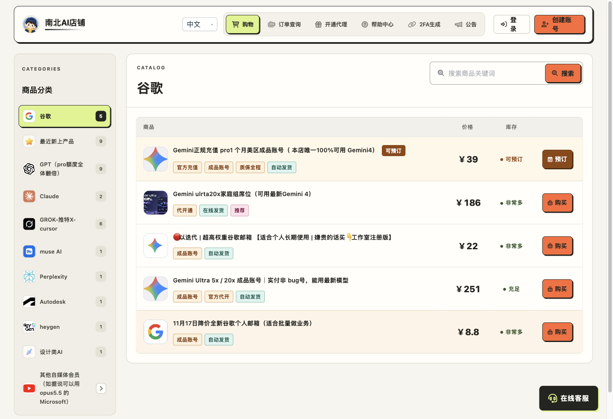
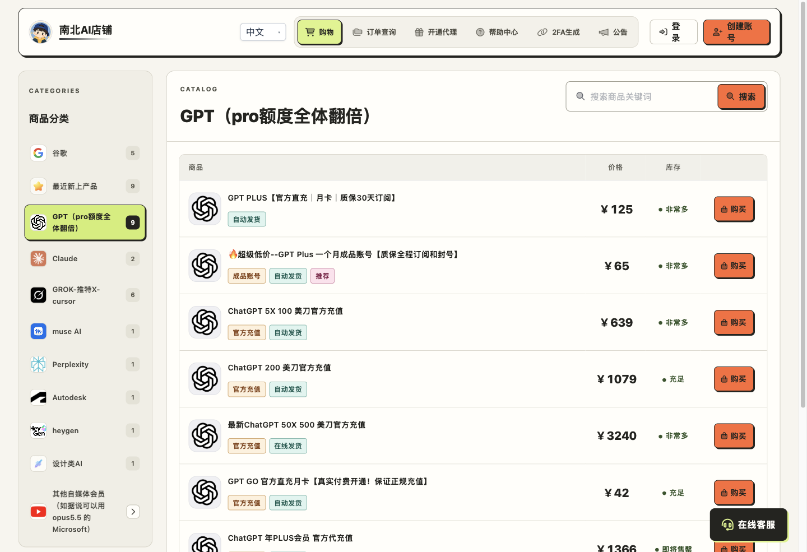
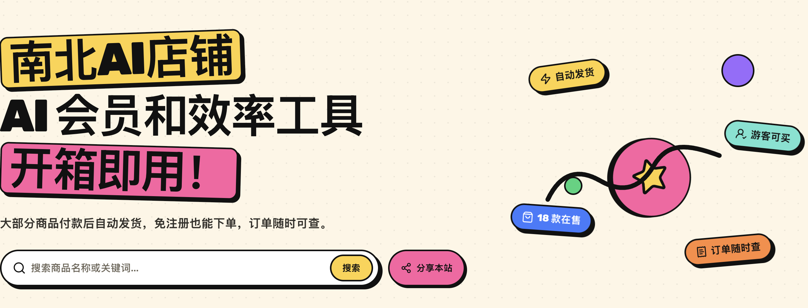
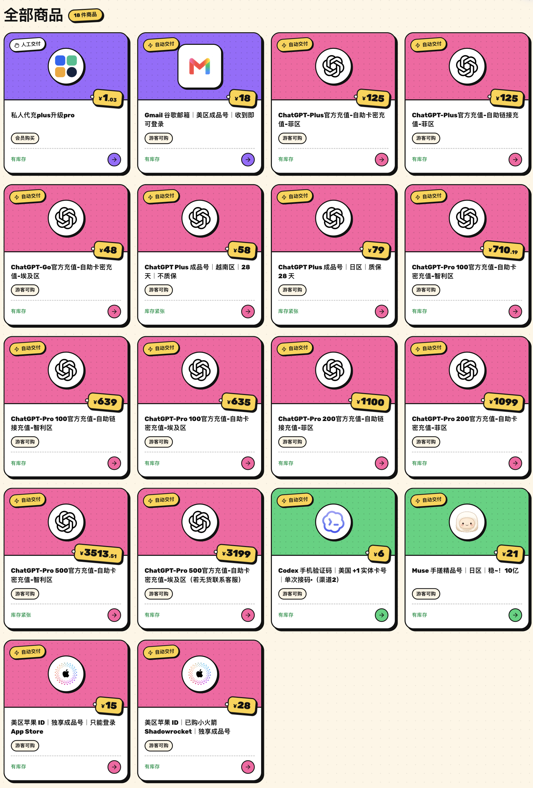

# 南北 AI 店铺｜AI 工具与会员服务

[打开主站 nanbei-ai.store](https://nanbei-ai.store/) · [打开副站 nanbei.ka8.ai](https://nanbei.ka8.ai/)

主站适合按工具找商品，分类包括 ChatGPT、Gemini、Claude、Grok / Cursor、Muse、Perplexity、Autodesk、HeyGen 和设计类 AI。副站目前以 ChatGPT 为主，也有 Muse、Codex 相关商品、Apple ID 和效率工具。两站各自展示商品、价格和库存，订单请回到下单的站点查询。

## 主站 nanbei-ai.store

[浏览主站](https://nanbei-ai.store/) · [查询主站订单](https://nanbei-ai.store/user/index/query) · [主站帮助中心](https://nanbei-ai.store/user/help/index)

从左侧选择分类，或在右上方搜索商品。列表会标明价格、库存，以及自动发货或在线发货等交付方式。主站公告说明支持游客下单，查询时使用下单时填写的联系方式。

### 主站 ChatGPT 与 Gemini

主站 ChatGPT 列表有 Go 和 Plus 月卡、Plus 成品账号、Pro 不同档位、Plus 年付和 Codex 点数充值。Gemini 列表有成品账号及 Ultra 家庭组席位。购买前先看商品详情，确认是否使用自己的账号，以及地区、有效期和售后条件。

## 副站 nanbei.ka8.ai

[浏览副站](https://nanbei.ka8.ai/) · [查询副站订单](https://nanbei.ka8.ai/me/orders) · [副站使用教程](https://nanbei.ka8.ai/blog)

首页可搜索商品，也可以在「按分类逛」切换分类。ChatGPT 列表包含 Go、Plus 和 Pro 方案，可看到卡密自助充值、链接自助充值与成品账号等不同交付方式。商品卡片会标注自动或人工交付、游客可购或会员购买，以及库存状态。

副站公告注明，其会员渠道充值服务主要面向海外用户及境外学习、工作场景，暂不支持中国大陆地区用户购买或使用。下单前请查看公告和商品详情中的适用条件。

## 部分商品列表价

以下价格为 2026 年 11 月 18 日页面记录，部分商品可能需要预订。两站同名会员的地区、交付和售后条件可能不同，请按商品详情核对。

| 站点 | 商品 | 页面标价 |
| --- | --- | ---: |
| 主站 | GPT Go 月卡直充 | ¥42 |
| 主站 | GPT Plus 月卡直充 | ¥125 |
| 主站 | GPT Plus 一个月成品账号 | ¥65 |
| 主站 | Gemini Pro 一个月美区成品账号（可预订） | ¥39 |
| 主站 | Gemini Ultra 20x 家庭组席位 | ¥186 |
| 副站 | ChatGPT Go 埃及区自助卡密充值 | ¥48 |
| 副站 | ChatGPT Plus 菲律宾区自助充值（卡密或链接） | ¥125 |
| 副站 | ChatGPT Plus 成品号（越南区或日本区） | ¥58 / ¥79 |

## 订单与售后

- 主站订单走主站「订单查询」，副站订单走副站「查订单」。
- 遇到交付或激活问题，在下单站点联系在线客服，提供订单号、商品名和问题截图。发送截图前请遮住密码、验证码和支付信息。
- 购买咨询可微信联系 `duanyp0809`（备注 GitHub）。

副站全部商品截图摄于 2026 年 11 月 19 日，其余截图摄于 11 月 18 日。商品价格、库存、交付和售后以实时商品页为准。南北 AI 店铺为独立第三方销售渠道，店铺名称不代表相关品牌授权。
