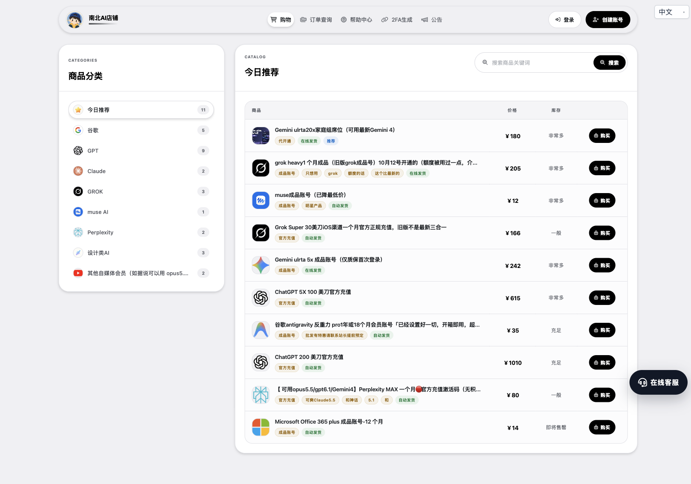
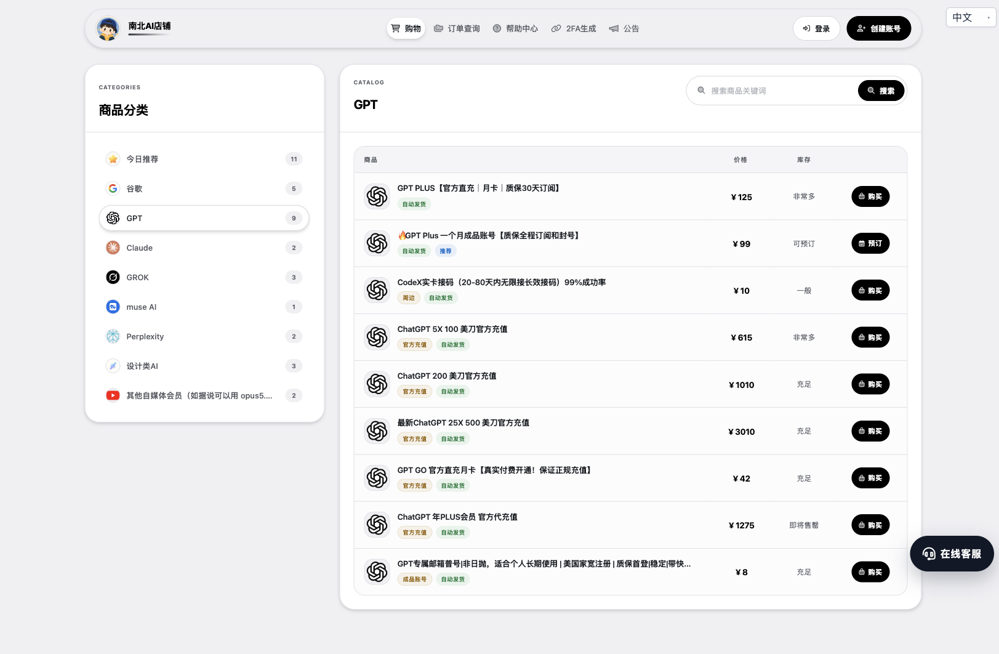
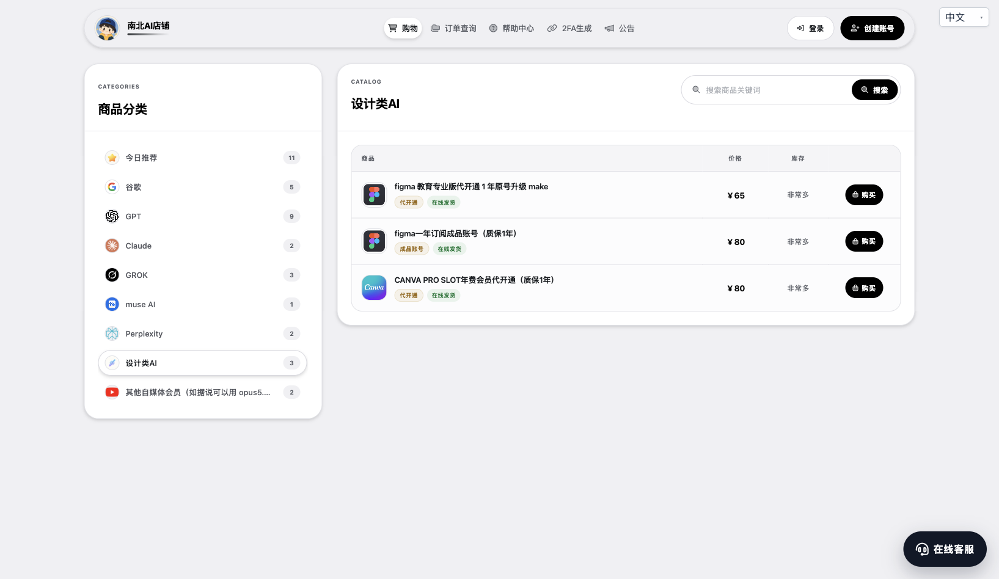

# 南北 AI 店铺｜AI 订阅与充值推广素材

网站：[nanbei-ai.store](https://nanbei-ai.store/)

价格与截图采集日期：2026 年 10 月 25 日（北京时间）。本文依据网站公开页面整理，价格、库存及服务条款以购买时的商品详情和所选规格为准。

## 可直接使用的推广文案

### 社群版

平时用 AI 写作、编程、查资料，想找个能集中看价格和选方案的地方，可以看看我自己的南北 AI 店铺：

https://nanbei-ai.store/

目前 GPT Plus 月卡 ¥125 起，GPT GO 月卡列表价 ¥42；也有 Gemini、Claude、Grok、Perplexity 等品类，以及 Figma、Canva 等设计工具相关服务。

不同预算、不同使用方式可以分开选：自己的账号充值、代开通、成品账号和家庭组席位，商品页会注明具体类型。部分商品支持自动发货，站内也有订单查询和在线客服入口。

先看清对应套餐、账号要求、库存和售后范围，再选适合自己的方案。价格及库存以页面实时显示为准。

### 朋友圈短版

自己的南北 AI 店铺，欢迎有需要的朋友来看看。

GPT Plus 月卡 ¥125 起，GPT GO 月卡列表价 ¥42，另有 Gemini、Claude、Grok、Perplexity 和设计工具相关品类。充值、代开通、成品账号等方案按需选择，具体价格、库存和售后说明都在商品页。

入口：https://nanbei-ai.store/

### 图文标题备选

- 常用 AI 订阅集中选：南北 AI 店铺价格与品类一览
- GPT Plus 月卡 ¥125 起，还有这些 AI 与设计工具可选
- 写作、编程、检索、设计：按用途选择 AI 订阅方案

## 网站优势怎么讲

### 价格档位清楚，方便按预算筛选

网站将商品和人民币标价并排展示，可以先看价格再打开详情。GPT 品类既有 GO 月卡，也有 Plus 月卡、年订阅和其他档位，不必把不同方案混在一起询价。

| 商品或方案 | 采集时页面标价 | 需要同时说明的条件 | 页面来源 |
| --- | ---: | --- | --- |
| GPT Plus 月卡 | ¥125 起 | 详情中渠道 1 为 ¥125，渠道 3 为 ¥130；账号条件不同 | [商品详情](https://nanbei-ai.store/item/51) |
| GPT Plus 一个月成品账号 | ¥99 | 列表显示“可预订”，不能宣传为现货；成品账号与原号充值不是同一种服务 | [商品入口](https://nanbei-ai.store/item/84) |
| GPT GO 月卡 | ¥42 | 列表价；套餐权限及适用条件需查看详情 | [商品入口](https://nanbei-ai.store/item/152) |
| muse 成品账号 | ¥12 | 成品账号，不能与其他平台会员直接比较权益 | [商品入口](https://nanbei-ai.store/item/442) |
| Gemini Ultra 20x 家庭组席位 | ¥180 | 家庭组席位，不能表述成独享账号或个人完整订阅；周期需查详情 | [商品入口](https://nanbei-ai.store/item/27) |
| Perplexity MAX 一个月激活码 | ¥80 | 商品标题标注“无积分”；模型与功能范围未独立验证 | [商品入口](https://nanbei-ai.store/item/187) |
| Figma 教育专业版代开通 1 年 | ¥65 | 教育版本，适用资格及开通条件需先确认 | [商品入口](https://nanbei-ai.store/item/352) |
| Figma 一年订阅成品账号 | ¥80 | 成品账号；列表标题标注质保 1 年，范围以详情为准 | [商品入口](https://nanbei-ai.store/item/171) |
| Canva Pro SLOT 年费会员代开通 | ¥80 | SLOT 席位类方案，不应宣传为个人独享完整订阅 | [商品入口](https://nanbei-ai.store/item/172) |

这里能够确认的价格卖点是“有多个价位可选、公开标价、方便筛选”。尚未做同规格竞品或官方价格对比，因此不能据此声称全网最低、比官方便宜多少或折扣幅度。

### 品类集中，覆盖多种使用需求

侧栏显示 8 个业务分类，另有“今日推荐”聚合入口：谷歌、GPT、Claude、GROK、muse AI、Perplexity、设计类 AI、其他自媒体会员。

面向写作和编程用户，可介绍 GPT、Claude、Gemini 等品类；面向资料检索用户，可介绍 Perplexity；面向设计和内容制作用户，可介绍 Figma、Canva。这里介绍的是选购方向，不代表不同商品具有相同功能或订阅权益。

### 购买方式多，流程入口集中

公开页面可见充值、代开通、成品账号、家庭组席位等商品类型，适合先按“用自己的号还是购买新账号”筛选。部分商品标注自动发货，另一些标注在线发货；不能统一承诺全部秒到账或全天人工在线。

GPT Plus 月卡详情说明付款后自动发放 CDK，并提供后续激活流程。站内有订单查询、帮助中心和在线客服入口。此次仅核验公开页面，没有下单测试，因此不对实际到账速度、客服响应或售后履约作保证。

## 网站实拍截图

以下图片均由 ego-browser 对真实网页截图，未改动商品、价格或库存。

### 1. 首页：品类与推荐商品

图注可用：常用 AI 与设计工具集中选购，商品类型、标价和库存状态一页查看。截图中的版本名称、功能和宣传标签属于网站商品描述，未经独立验证。

### 2. GPT 分类：月卡、年订阅与不同方案

图注可用：GPT Plus 月卡 ¥125 起，GO 月卡列表价 ¥42；¥99 成品账号当前为预订状态。不同商品的账号归属、周期和权益不同。

### 3. 设计工具：Figma 与 Canva

图注可用：除 AI 对话工具外，也提供 Figma、Canva 相关方案。教育版本、成品账号和席位类商品请先确认适用条件。

## 发布前核对

- 重新打开商品页核对价格、规格和库存，尤其不要将“可预订”写成现货。
- GPT Plus 月卡详情的质保范围为订阅异常掉线，不含账号封禁；不得改写成全包售后或封号包赔。
- “官方充值”是商品页面的命名，不能据此宣传店铺是官方授权代理；授权身份未核验。
- 截图中包含的最新模型、额度、成功率及“最低价”等说法没有独立核验，推广正文不重复背书。
- 在允许商业推广的渠道发布；当前交付仅为本地素材，未向任何平台发布。

## 项目内容

当前项目只包含这份 Markdown 和 3 张截图，便于后续继续补充推广内容，无应用代码或运行依赖。
